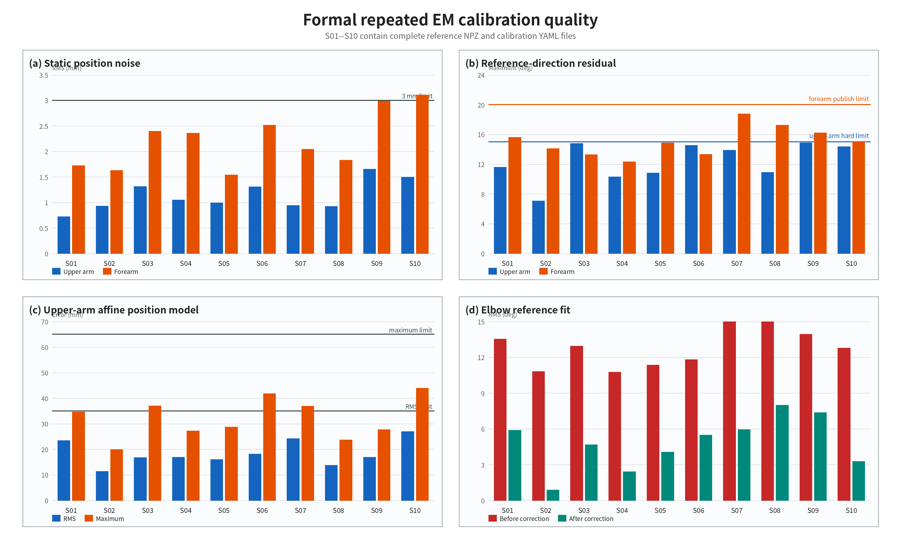
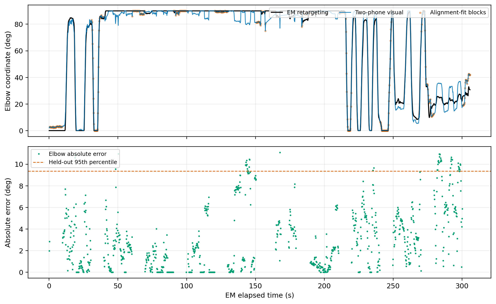
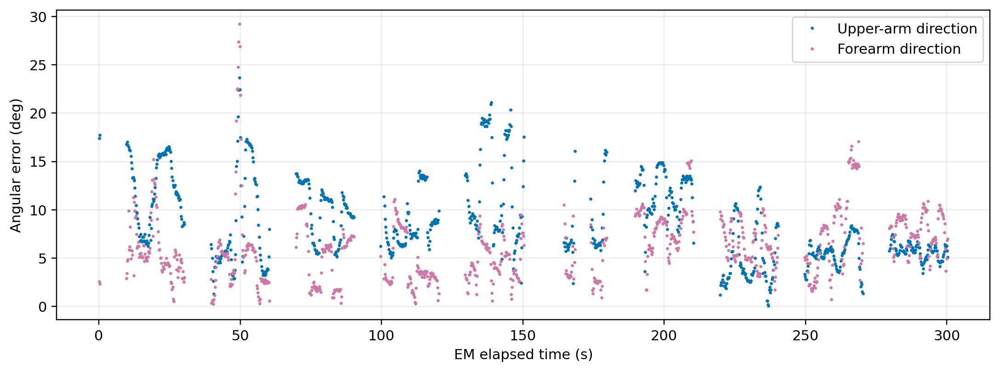
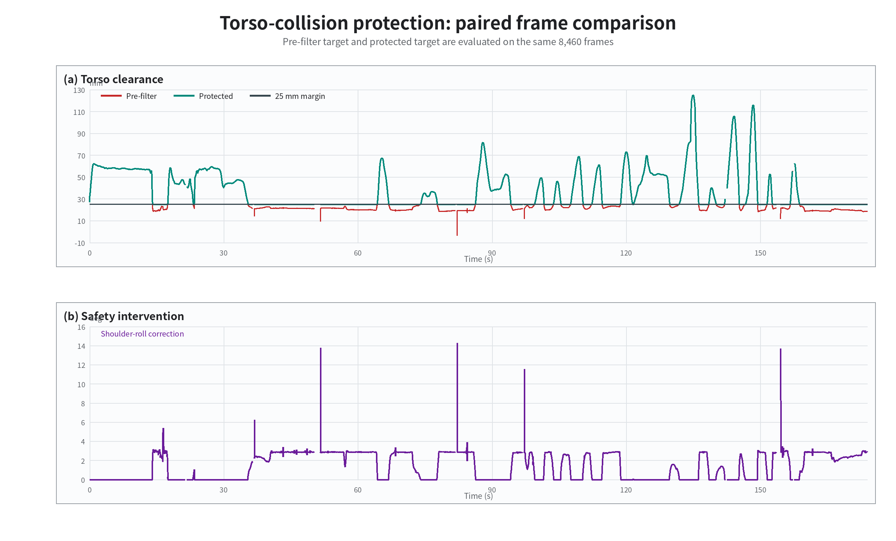
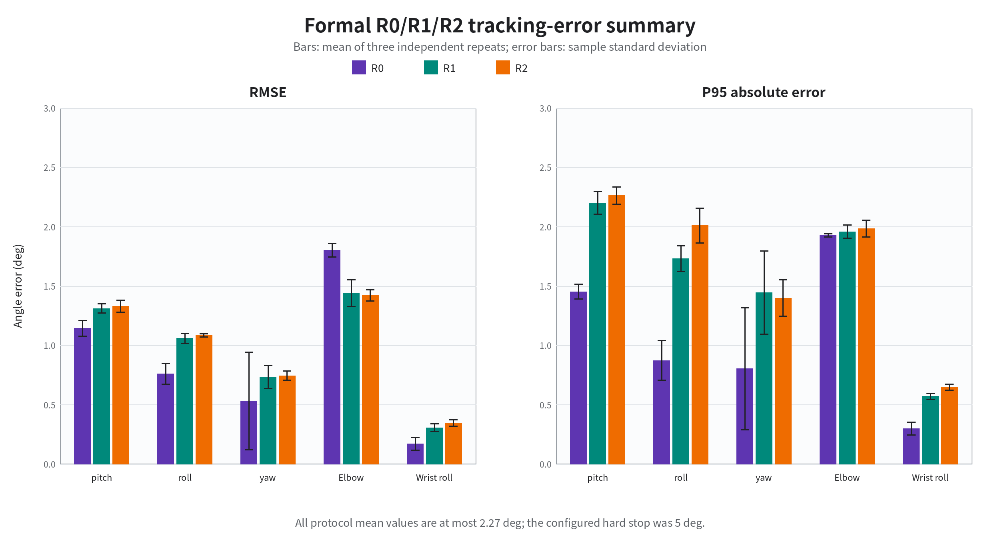
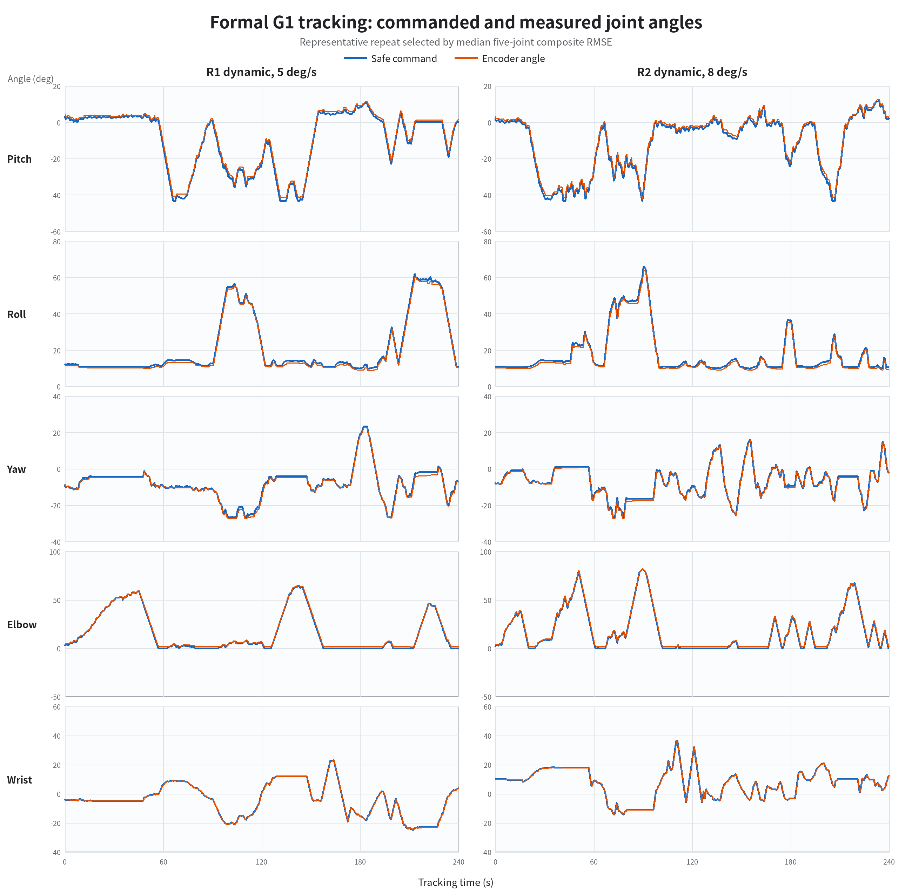
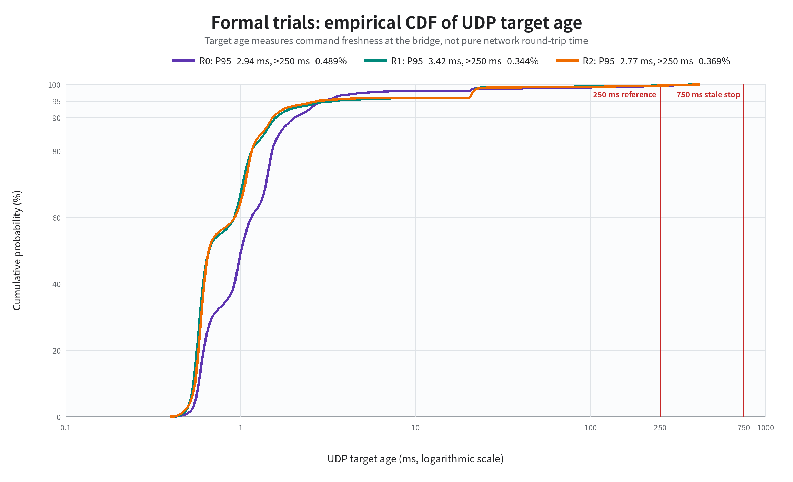

# 第7章 实验结果与分析

## 7.1 实验数据与评价方法

本章围绕三个问题组织实验结果：第一，双接收器电磁系统能否准确、稳定地估计人体左臂动作；
第二，重定向、模型修正和安全保护是否按预期工作；第三，Unitree G1能否安全跟踪目标并完成
任务。开发期间用于定位故障的终端输出不逐条列入正文，只保留能够回答上述问题的可复核证据。

系统开发和真机验证期间共保存135份可统一复核的`g1_arm_tracking_*.csv`，包含495,420帧，
记录时长合计9,904.60 s，约165.1 min。逐文件统计和SHA-256清单保存在项目实验记录目录中。
本章将数据分为五类：

| 数据类型 | 用途 | 能否作为正式结论 |
|---|---|---|
| 正式协议重复 | R0、R1和R2各三次完整跟踪 | 用于本章真机执行性能的主要定量结论 |
| 双手机视觉留出验证 | 两部手机、刚性标记和同步EM轨迹 | 用于人体方向与肘角的跨模态一致性结论 |
| 已审核预实验 | 有动作标签、终端记录和明确完成状态 | 可报告定量结果，但注明为预实验 |
| 开发性全量记录 | 描述总体误差、覆盖时长和通信长尾 | 不能据此计算正式成功率 |
| 功能性观察 | 说明算法分支、保护和异常是否真实出现 | 可证明功能接入，不能替代配对统计 |

真机跟踪误差定义为安全桥实际下发的命令角与编码器角之差：

\[
e_i(k)=q_{c,i}(k)-q_{a,i}(k),
\]

其中，\(q_{c,i}\)为第\(i\)个关节经过限位和限速后的命令角，\(q_{a,i}\)为G1编码器角。
据此计算RMSE、P95绝对误差和最大绝对误差。该误差评价“机器人是否执行了安全命令”，不能
评价“人体动作是否估计正确”。人体估计精度需要外部视觉参考；本章进一步将视觉数据划分为
对齐拟合块和未参与拟合的留出块，避免在同一批帧上同时估计参数和报告误差。50 Hz连续帧
也不能当作彼此独立的重复试次。

## 7.2 电磁标定与重复试验稳定性

### 7.2.1 输入有效性检查

开发初期出现过大臂四元数模长约0.707、前臂保持1.000的异常。一次有效试验中，两接收器
四元数模长中位数均为1.000000，位置隐含运动范围为73.3°，大臂和前臂报告的姿态范围分别
为85.7°和71.4°。异常试验中，大臂模长中位数降为0.711003，大臂报告姿态范围只有16.3°，
而位置仍显示71.7°运动；接收器对的平移和方向残差上升至127.4 mm和23.0°。

这说明该现象属于上游数据失效，而不是普通佩戴误差。采集节点随后加入0.95–1.05的模长
门控，异常数据整对丢弃，不通过强制归一化进入标定或真机。两次早期直臂刚性扫描虽然失败，
但后来确认测试中前臂发生了主动旋转，因此违反了刚性假设，不能据此判定接收器损坏。

### 7.2.2 S01–S10重复标定结果

按照统一的拆下、重新佩戴和重新标定流程完成S01–S10共10轮参考动作采集。每轮包含7种
参考姿势、每种重复3次，即21组大臂/前臂参考位姿；转掌段保存381–401帧。十轮均保存了
参考NPZ和结果YAML。

| 会话 | 参考姿势组 | 转掌帧 | 参考NPZ | 结果YAML | 可判定结果 |
|---|---:|---:|---|---|---|
| S01 | 21 | 401 | 有 | 有 | 通过 |
| S02 | 21 | 401 | 有 | 有 | 通过 |
| S03 | 21 | 381 | 有 | 有 | 通过 |
| S04 | 21 | 381 | 有 | 有 | 通过 |
| S05 | 21 | 381 | 有 | 有 | 通过 |
| S06 | 21 | 401 | 有 | 有 | 通过 |
| S07 | 21 | 401 | 有 | 有 | 通过 |
| S08 | 21 | 400 | 有 | 有 | 通过 |
| S09 | 21 | 401 | 有 | 有 | 通过 |
| S10 | 21 | 401 | 有 | 有 | 通过（静态警告） |

十轮的`dry_run_only`均为`false`。S02–S06生成时记录的前臂发布门槛为15°，S01和
S07–S10采用最终20°门槛；为统一比较，本节按大臂15°、前臂20°重新判定。S02–S06的
前臂最大残差均不超过14.88°，因而在两种标准下结论相同。

| 会话 | 静态位置RMS U/F (mm) | 静态姿态RMS U/F (°) | 方向最大残差 U/F (°) | 位置模型RMS/max (mm) | 肘角RMS修正前/后 (°) |
|---|---:|---:|---:|---:|---:|
| S01 | 0.72/1.72 | 0.47/0.66 | 11.58/15.58 | 23.47/34.66 | 13.53/5.90 |
| S02 | 0.93/1.63 | 0.23/0.44 | 7.04/14.10 | 11.31/19.96 | 10.81/0.89 |
| S03 | 1.31/2.40 | 0.35/0.58 | 14.79/13.28 | 16.76/37.02 | 12.95/4.68 |
| S04 | 1.05/2.36 | 0.39/0.69 | 10.29/12.30 | 16.95/27.27 | 10.76/2.41 |
| S05 | 0.99/1.54 | 0.21/0.26 | 10.80/14.88 | 16.04/28.68 | 11.35/4.04 |
| S06 | 1.31/2.52 | 0.45/0.54 | 14.53/13.33 | 18.22/41.76 | 11.82/5.48 |
| S07 | 0.94/2.04 | 0.27/0.34 | 13.87/18.76 | 24.23/36.93 | 16.21/5.94 |
| S08 | 0.92/1.83 | 0.28/0.30 | 10.89/17.26 | 13.76/23.63 | 15.38/7.98 |
| S09 | 1.66/2.99 | 0.57/0.68 | 14.89/16.19 | 16.88/27.74 | 13.94/7.36 |
| S10 | 1.50/3.11 | 0.49/0.52 | 14.36/15.00 | 27.02/43.88 | 12.78/3.28 |

十轮结果中，大臂和前臂静态位置RMS分别为1.13±0.30 mm和2.21±0.55 mm，静态姿态
RMS分别为0.37±0.12°和0.50±0.16°。大臂和前臂参考方向最大残差分别为
12.30±2.60°和15.07±1.97°；位置模型RMS为18.46±4.92 mm，最大误差为
32.15±7.88 mm。扭转轴拟合RMS为2.84±0.86°，转掌动作范围为65.91±7.07°。
十轮在统一方向门槛下均通过，其中9轮满足3 mm静态位置建议值；S10的前臂静态位置RMS为
3.11 mm，属于成功但带静态警告。肘角修正将参考点RMS由12.95±1.86°降至4.80±2.20°，
但这仍是标定内部拟合结果，
不能替代独立人体真值误差。

### 7.2.3 重复性结论的证据边界

现有数据支持“在本操作者、本设备配置和既定重新佩戴流程下，标定能够跨会话稳定产生可发布
参数”：十轮最终结果均通过方向门槛，发布通过率为10/10，无静态警告比例为9/10。该比例
针对归档的会话最终结果，不等同于未归档中间尝试的首次成功率，也不能外推至其他操作者、
绑带形式或发射器布局。

## 7.3 人体姿态估计准确性

### 7.3.1 双手机视觉参考系统与同步

为避免使用标定内部残差评价标定自身，本研究采用两部手机和刚性视觉标记构建外部视觉参考。
ID 10标记与大臂EM接收器安装在同一刚性支架，ID 20标记与前臂接收器安装在另一刚性支架；
标记黑色方框实测边长为58 mm。标记与接收器之间的机械关系在实验过程中保持不变，因此无须
在每次重新佩戴后重复拍摄二者的刚性关系。评价动作覆盖自然起始姿势、直臂下垂、前举、侧举、
斜向抬举以及不同程度的屈伸肘；本节不评价直臂转掌。

两部手机均以约60帧/s记录1920×1072视频。手机A和B的单目标定重投影RMS分别为
0.832 pixel和0.850 pixel；双目标定基线为0.3339 m，双目RMS为0.921 pixel，对极误差
中位数和P95分别为0.563 pixel和1.741 pixel。标记位姿由IPPE平面PnP求解，并以5 Hz
形成比较轨迹。录像时间关系为：

\[
t_B=0.9999t_A+17.48\ \mathrm{s},
\qquad
t_A=1.00075t_{EM}+35.90\ \mathrm{s}.
\]

视觉与EM的肘角轨迹相关系数约为0.976。EM记录包含15,108帧、306.02 s；在完整视觉
时间网格中，大臂和前臂均可形成方向估计的比例为89.7%。

### 7.3.2 留出验证协议与误差定义

本次评价没有单独增加视觉解剖对齐录像，固定标记轴、手机A到人体坐标系的旋转以及视觉肘角
零点/增益采用分段留出方法估计。完整轨迹按连续10 s时间块划分，每三个时间块中的一个仅
用于估计固定参数，其余两个不参与拟合，只用于最终误差评价。标记开始或结束遮挡前后的
0.4 s样本被排除。最终形成1,446个同步5 Hz样本，其中463个为拟合样本，983个为留出
验证样本。视觉肘角关系仅由拟合块确定：

\[
\theta_{e,vis}=\operatorname{clip}
\left(1.4454\theta_{e,vis}^{raw}-18.99^\circ,0^\circ,90^\circ\right).
\]

视觉与EM分别计算大臂单位方向\(\hat{\mathbf u}\)、前臂单位方向
\(\hat{\mathbf f}\)和肘角\(\theta_e\)，留出误差定义为：

\[
e_u=\arccos\!\left(\hat{\mathbf u}_{EM}^{T}\hat{\mathbf u}_{vis}\right),\qquad
e_f=\arccos\!\left(\hat{\mathbf f}_{EM}^{T}\hat{\mathbf f}_{vis}\right),
\]

\[
e_e=\left|\theta_{e,EM}-\theta_{e,vis}\right|.
\]

这一划分保证报告的983个样本未参与固定参数估计。但拟合块与留出块来自同一次记录，因此
本节结论表述为“留出跨模态一致性”，而不是完全独立的绝对光学真值精度。

### 7.3.3 方向与肘角留出结果

| 误差量 | 平均值 (°) | RMSE (°) | 中位数 (°) | P95 (°) | 最大值 (°) |
|---|---:|---:|---:|---:|---:|
| 大臂方向 | 8.77 | 9.76 | 7.67 | 16.77 | 23.66 |
| 前臂方向 | 6.17 | 7.12 | 5.87 | 11.05 | 29.21 |
| 肘角绝对误差 | 3.06 | 4.22 | 2.25 | 9.37 | 11.08 |

肘角误差中位数为2.25°、RMSE为4.22°，95%的留出样本不超过9.37°。前臂方向误差
RMSE为7.12°，低于大臂方向的9.76°，说明当前系统对肘屈伸及前臂方向的估计优于大臂
绝对方向。

肘角图上半部分给出EM与视觉时序，橙色点只表示参数拟合块；下半部分仅绘制留出样本的
绝对误差，虚线为9.37°的P95。曲线缺口对应拟合块或视觉遮挡，并不表示零误差。

方向误差随姿态变化，而不是均匀白噪声。大臂在部分前举和转换区间形成15°–20°误差平台；
前臂多数样本位于2°–10°，但也存在短时峰值。两部手机在共同可见帧中独立估计标记纵向的
差异中位数为大臂5.82°、前臂6.74°，因此视觉—EM差值同时包含视觉参考误差，不能全部
归因于EM系统。

### 7.3.4 共同方向偏差与肘角稳定性

约50 s处，大臂和前臂方向误差同时短时增大。例如49.66 s时，两者误差分别为23.7°和
29.2°，但肘角误差仅为3.3°。若两个肢段方向受到近似相同的整体旋转\(R\)，则：

\[
(R\hat{\mathbf u})^T(R\hat{\mathbf f})
=\hat{\mathbf u}^T\hat{\mathbf f}.
\]

因此绝对方向可以同时偏移，而二者相对夹角仍然保持。该峰值持续时间短并迅速恢复，更符合
动作转换时的共同方向偏差、5 Hz视觉取样和残余对时误差共同作用，而不是肘角估计持续失效。
这也解释了为何肘角RMSE明显低于单个肢段的绝对方向RMSE。

## 7.4 模型修正与碰撞保护

### 7.4.1 大臂位置模型与肘角修正

多轮测试表明，大臂仿射位置模型通常能够支持前举和侧举，但部分安装在前举过程中出现超过
50 mm的模型误差，并连续触发丢帧和停止发布。这一现象在人体距离机器人约2 m时仍出现，
说明原因更可能是安装变化、接收器局部运动、发射器相对位置或模型覆盖不足，不能简单归因于
机器人金属干扰。安全策略保持为：超出门槛时丢弃该帧，而不是为继续运动而放宽门槛。

S01–S10的肘角安装级仿射修正在标定参考点上把内部RMS由12.95±1.86°降至
4.80±2.20°。双手机留出验证进一步表明最终输出肘角与视觉参考之间的RMSE为4.22°，
说明修正后的完整链路能够在未参与固定对齐参数估计的时间块中保持一致。但本次视觉肘角
零点/增益以修正后EM输出为拟合目标，不能据此计算“开启与关闭肘角修正”的独立净收益；
如需完成该消融，仍需在相同视觉轨迹上离线重放修正前、修正后两套映射。

### 7.4.2 躯干碰撞保护

人体手臂贴近身体时，未保护的机器人目标可能使左臂进入躯干。S06之后完成了一轮25 mm
躯干间隙过滤实验，共保存8,460个有效帧、173.90 s，有效采样率48.64 Hz。每一帧同时
保存过滤前和保护后目标，因而可以进行同帧配对比较，无需操作者重复完全相同的第二条轨迹。

| 指标 | 过滤前目标 | 保护后目标 |
|---|---:|---:|
| 最小间隙 | −3.70 mm | 25.00 mm |
| 间隙P05 | 18.95 mm | 25.00 mm |
| 间隙中位数 | 23.47 mm | 25.00 mm |
| 低于25 mm的帧数 | 4,492 | 0 |
| 几何穿入帧数 | 1 | 0 |

过滤器在4,492帧（53.10%）中介入，且没有触发保持上一安全目标。介入时肩roll修正量
中位数为2.84°、P95为2.92°、最大为14.27°；限制部位主要为大臂（4,306帧），其次为
手部（184帧）和前臂（2帧）。

过滤器只修改机器人安全目标，不反向修改人体估计。结果证明本次有效数据中保护后几何间隙
始终不低于25 mm，但这不是机器人发生实体接触后的力学安全实验，不能外推为任意动作下的
绝对无碰撞保证。

| 模块 | 已有证据 | 尚缺少的正式结果 |
|---|---|---|
| 大臂仿射位置模型 | 有标定误差及在线门控记录 | 同一视觉轨迹下与其他模型配对比较 |
| 肘角仿射修正 | 有标定内部修正前后结果 | 独立动作的修正前后误差 |
| 碰撞过滤器 | 已完成8,460帧同帧配对；保护后最小间隙25 mm、无穿透 | 不需要补测；如研究实体接触力，需另设力学实验 |

碰撞过滤器的几何消融已经由现有NPZ完成；位置模型和肘角修正的独立精度仍需视觉真值。

## 7.5 G1关节跟踪性能

### 7.5.1 网络、状态与平滑接管

主机通过`enx6c1ff701509c`与G1的`192.168.123.161`通信，实测往返时间约0.17–0.44 ms且
无丢包。只读FSM监视器能够识别零力矩、阻尼、锁定站立和官方常规运控状态。固定肘关节
5°试验中，肘角由55.76°移动到约60.50°，目标为60.76°，随后平滑返回并释放Arm SDK。

在所有关节目标固定为接管瞬间实测值时，Arm SDK权重分别升至0.10、0.20和0.25，三次
零动作接管诊断均通过。

| 最大权重 | 最大观测关节速度 | 最大关节漂移 | 结果 |
|---:|---:|---:|---|
| 0.10 | 0.057 rad/s | 0.02° | 通过，权重返回零 |
| 0.20 | 0.057 rad/s | 0.05° | 通过，权重返回零 |
| 0.25 | 0.045 rad/s | 0.05° | 通过，权重返回零 |

结果表明平滑接管本身不会造成明显关节跳变；权重达到1之后，接管渐变也不会继续增加正常
跟随延迟。

### 7.5.2 单关节与小范围组合

单关节与小范围组合预实验共完成33轮，其中32轮完整结束，1轮因目标流陈旧中止。
完整试次共56,750帧。

| 关节 | 已覆盖范围 | 完整试次数 | RMSE范围 | 最大绝对误差 |
|---|---|---:|---:|---:|
| shoulder pitch | 5–20°单侧包络 | 5 | 0.88–1.35° | 2.96° |
| shoulder roll | 5–20°包络 | 5 | 1.36–1.79° | 3.39° |
| shoulder yaw | ±5–±15° | 4 | 0.51–0.71° | 1.26° |
| elbow | 5–45°，3–5°/s | 6 | 0.27–0.60° | 1.54° |
| wrist roll | ±5–约±30° | 5 | 0.29–0.36° | 0.90° |

肘、腕和肩yaw的RMSE均低于0.8°，pitch最大RMSE为1.35°。roll的RMSE最高达到1.79°，
最大误差3.39°，说明横向抬臂时负载影响最明显。所有完整单关节试次均低于5°硬停止阈值。

五关节5°组合试验结果如下。

| 关节 | pitch | roll | yaw | elbow | wrist |
|---|---:|---:|---:|---:|---:|
| RMSE | 0.60° | 1.39° | 0.54° | 0.34° | 0.34° |
| 最大误差 | 1.76° | 2.37° | 1.06° | 0.83° | 0.86° |

五关节同时达到至少2.5°幅值的累计时间为3.92 s，说明该记录包含真实协同动作，而非只有
一个关节运动。

### 7.5.3 逐级扩大范围

扩大范围预实验保持最大命令速度5°/s，逐级扩大五关节安全包络。第三档首次运行因目标流
陈旧中止，随后使用相同配置重试完成。

| P/R/Y/E/W包络 | pitch RMSE/max | roll RMSE/max | yaw RMSE/max | elbow RMSE/max | wrist RMSE/max | 最大倾角 |
|---|---:|---:|---:|---:|---:|---:|
| 20/20/15/30/20° | 0.92/2.91° | 1.65/3.63° | 0.49/1.41° | 0.48/1.15° | 0.28/0.95° | 1.97° |
| 25/20/15/35/25° | 1.05/3.24° | 1.84/3.32° | 0.52/1.41° | 0.62/2.58° | 0.34/0.96° | 2.13° |
| 30/25/15/45/30°重试 | 1.01/3.37° | 2.12/3.92° | 0.51/1.56° | 0.89/4.83° | 0.29/0.95° | 2.11° |

三档完整试验中所有关节最大误差均低于5°。最大档elbow瞬时误差达到4.83°，接近硬停止
阈值，但其RMSE为0.89°、P95为1.05°，说明峰值属于短时动态滞后。最大档wrist相对幅值
只达到18.38°，不能据此声称已经验证完整30°范围。

### 7.5.4 绝对对齐与正式R0/R1/R2

后续系统从相对起点映射改为绝对对齐：接管后冻结人体目标，让机器人低速到达同一关节角，
误差进入容差后再开始跟随。该流程避免了接管瞬间的姿态跳变，但要求人体在对齐阶段保持
静止。pitch和roll还加入最大3 N·m重力前馈；现有数据证明前馈可以安全启用，但没有同一
动作的严格开/关配对，因此不能声称已经量化其改善量。

正式试验使用固定协议。五关节包络pitch/roll/yaw/elbow/wrist分别为
60/60/25/60/30°，pitch和roll重力前馈峰值均为3 N·m。每次佩戴后均执行相同标定流程；
除协议规定的最大命令速度外，其余控制参数、动作顺序和验收标准保持一致。下表帧数只包含
绝对对齐完成后的正式跟踪段。

| 协议 | 动作内容 | 跟踪时长 | 最大命令速度 | 重复数 | 有效帧数 |
|---|---|---:|---:|---:|---:|
| R0 | 绝对对齐后保持当前五关节姿态 | 60 s | 5°/s | 3 | 9,003 |
| R1 | 固定顺序的五关节动态跟随 | 240 s | 5°/s | 3 | 36,003 |
| R2 | 与R1相同的五关节动态跟随 | 240 s | 8°/s | 3 | 36,003 |

九次有效试次共包含81,009个正式跟踪帧，合计27 min。另有一次尝试在跟踪开始前因
人体肘部在绝对对齐期间移动4.1°，超过4.0°保持门槛而自动停止；该尝试没有进入
正式跟踪，因而不进入R0/R1/R2统计。

下列两表分别给出三次重复的RMSE和P95绝对误差的均值及样本标准差。RMSE表最后一列
为该协议所有关节和所有重复中的最大绝对误差，单位均为度。

| 协议 | pitch | roll | yaw | elbow | wrist | 全局最大误差 |
|---|---:|---:|---:|---:|---:|---:|
| R0 | 1.14±0.07 | 0.76±0.09 | 0.53±0.41 | 1.80±0.06 | 0.17±0.05 | 2.52° |
| R1 | 1.31±0.04 | 1.06±0.04 | 0.73±0.10 | 1.44±0.11 | 0.31±0.03 | 3.15° |
| R2 | 1.33±0.05 | 1.08±0.01 | 0.74±0.04 | 1.42±0.05 | 0.35±0.03 | 3.15° |

| 协议 | pitch P95 | roll P95 | yaw P95 | elbow P95 | wrist P95 |
|---|---:|---:|---:|---:|---:|
| R0 | 1.45±0.06 | 0.87±0.17 | 0.80±0.51 | 1.93±0.01 | 0.30±0.05 |
| R1 | 2.20±0.10 | 1.73±0.11 | 1.44±0.35 | 1.96±0.06 | 0.57±0.03 |
| R2 | 2.26±0.07 | 2.01±0.15 | 1.40±0.15 | 1.98±0.07 | 0.65±0.02 |

下图将以上RMSE和P95结果可视化。柱高为三次独立重复的均值，误差棒为样本标准差。静态R0
的肘关节RMSE相对较大，而动态R1和R2的pitch与roll尾部误差相对较大；但三种协议的全部
均值仍低于2.27°。

三种协议的所有关节RMSE均值均低于1.81°，P95均值均低于2.27°，最大绝对误差不超过3.16°，
低于5°硬停止门槛。R1与R2的各关节RMSE差异不超过0.04°，说明在本试验动作和安全包络内，
将最大命令速度从5°/s提高到8°/s未导致明显的跟踪误差增长。由于每组只有三次独立重复，
该结论为描述性结论，不作显著性推断。

下图给出R1和R2的安全命令角与编码器角时序。为避免主观挑选，每个协议按五关节RMSE的
算术平均值排序，选择居中的一次重复作为代表。两种速度下五个关节的编码器曲线均紧邻安全
命令曲线，较明显的偏差主要出现在动作换向和快速过渡处，而不是持续发散。

安全裁剪按“人体源目标超出本轮允许包络”逐帧统计。本研究采用“单次试验的任一单关节
裁剪率小于5%”作为小比例裁剪的工程验收条件。

| 协议 | pitch | roll | yaw | elbow | wrist | 单次最大值 |
|---|---:|---:|---:|---:|---:|---:|
| R0 | 0.00±0.00% | 0.00±0.00% | 0.00±0.00% | 0.00±0.00% | 0.00±0.00% | 0.00% |
| R1 | 1.37±2.22% | 0.00±0.00% | 2.45±1.87% | 0.00±0.00% | 0.41±0.55% | 4.61% |
| R2 | 1.24±1.26% | 0.31±0.54% | 0.99±0.55% | 0.00±0.00% | 0.74±0.80% | 2.52% |

九次试验的任一单关节裁剪率都低于5%，其中elbow在所有试次中均未裁剪。裁剪不会使
“安全命令—编码器”跟踪误差失效，但它表明机器人没有完整执行被裁掉的那一小段人体源目标，
因此表中同时报告跟踪误差和裁剪率，不对原始数据进行事后修改。

正式跟踪段中，R0、R1和R2的UDP目标年龄P95分别为2.943、3.418和2.770 ms，
超过250 ms的帧比例分别为0.489%、0.344%和0.369%；最大IMU倾角分别为1.96°、2.57°和
2.58°。目标年龄的经验累积分布如下。这里的目标年龄是安全桥消费UDP目标时的数据年龄，
包含上游生成、传输和进程调度，不等同于网络往返时间。九次有效试次均完成正式跟踪、
平滑释放控制权并保存CSV。

### 7.5.5 实时性与安全停止

全部135份真机CSV的汇总如下。该统计包含对齐阶段、开发中止和部分关节试验，只描述执行链
总体量级，不作为135次独立重复。

| 指标 | 全量结果 |
|---|---:|
| 文件/帧数/记录时长 | 135份 / 495,420帧 / 165.1 min |
| 目标年龄中位数 | 0.802 ms |
| 目标年龄P95 | 4.278 ms |
| 目标年龄最大值 | 742.7 ms |
| 超过250 ms的帧 | 2,637帧，0.532% |
| 最大IMU倾角 | 2.96° |
| 全量RMSE P/R/Y/E/W | 1.17/1.39/0.43/0.94/0.23° |
| 全量最大误差 P/R/Y/E/W | 5.06/4.00/2.71/4.83/1.04° |

主体目标年龄处于毫秒量级，但存在0.38–0.74 s稀疏长尾。已确认的陈旧目标停止均执行了
“停止跟随—平滑降低Arm SDK权重—保存CSV”，随后相同或更大范围的重试可以完成。这证明
看门狗和释放流程实际介入；扩大超时只能减少停止次数，不能改善信息新鲜度。

## 7.6 任务级验证

截至本章数据冻结时，已完成的真机实验主要验证关节跟踪、安全包络和停止行为，尚未完成具有
明确环境目标和成功判据的正式任务级实验。因此，现有结果不能被写成“机器人已完成某项
应用任务”。

最终只需选择一个简单且可重复的任务，例如：机器人左手从初始区域移动至固定标靶区域，
保持2 s后返回。每次试验必须定义起点、目标区域、保持时间和失败条件，建议重复10次，并
报告成功率、完成时间、完成时间标准差、安全停止次数和失败原因。任务级演示与正式统计应
使用同一个任务，避免“演示动作”和“论文任务”成为两套无法对应的内容。

该实验需要G1、EM和电脑，但不要求同时使用双手机。手机系统用于评价人体姿态真值，任务
级实验用于评价整个系统是否能够完成可观察的目标，两者回答的问题不同。

## 7.7 讨论

### 7.7.1 人体估计误差与机器人执行误差必须分开

正式R0/R1/R2和多轮单关节实验评价安全命令到G1编码器响应的执行误差；双手机实验评价
人体方向和肘角的跨模态一致性。两类误差不能混合：前者所有正式关节RMSE低于1.81°，并不
意味着人体方向也达到相同精度；后者显示大臂与前臂方向RMSE分别为9.76°和7.12°，肘角
RMSE为4.22°。当前系统的主要误差来源已从机器人低层关节跟踪转向人体绝对方向估计和
视觉/EM坐标对齐。

### 7.7.2 roll与大范围动作的负载影响

单关节和扩大范围试验中，roll持续误差通常大于yaw、elbow和wrist；扩大包络后roll RMSE
进一步增加。该趋势与横向抬臂时重力矩增大一致，但现有前馈试验缺少同轨迹开/关配对，不能
把误差变化完全归因于重力，也不能量化3 N·m前馈的净收益。

### 7.7.3 安全裁剪不是数据错误

正式R1和R2中的少量裁剪表示人体源目标短时超出了当次允许包络，安全桥主动限制机器人命令。
所有单次、单关节裁剪率都低于5%，因此按本研究的工程验收条件保留为有效试次。裁剪后的机器人
跟踪误差仍然有效，但它评价的是安全命令而不是被裁掉的那部分人体源目标。因此论文同时报告命令跟踪误差和
裁剪比例，不修改原始数据消除裁剪。

### 7.7.4 系统安全性证据

四元数门控、位置模型门控、目标新鲜度看门狗、跟踪误差保护、机身状态检查、碰撞过滤以及
Arm SDK平滑释放均在实际测试中触发过。现有结果能够证明这些保护不是只存在于代码中，但
安全保护触发并不等于试验成功；正式结果必须分别报告完成试次和中止试次。

## 7.8 局限性与剩余实验

目前第七章各结果模块的状态如下。

| 结果模块 | 所需设备 | 当前状态 | 最终需要补充 |
|---|---|---|---|
| 重复标定稳定性 | EM | S01–S10均完整；10/10可发布，9/10无静态警告 | 不需要补测；结论限于本操作者和设备配置 |
| 人体姿态准确性 | 双手机＋EM | 已完成留出跨模态验证；983个评价样本 | 不要求补测；结论限于留出一致性而非完全独立绝对真值 |
| 模型与碰撞消融 | 电脑＋已有NPZ | 碰撞保护已完成同帧配对 | 如需净收益，位置/肘角模型仍需同轨迹离线消融 |
| G1 R0/R1/R2 | G1＋EM | 已完成；各三次正式重复 | 不需要补测 |
| 任务级成功率 | G1＋EM | 尚未正式完成 | 一个任务约10次重复 |

除此之外，当前研究仍局限于单名操作者、左臂、低至中等速度和实验室环境。直臂转掌不属于
本研究的评价动作。双手机系统自身存在约5.82°–6.74°的方向差异中位数，且固定对齐参数
与留出样本来自同一次记录，因此结果只能证明跨模态留出一致性，不能把全部视觉—EM差值
解释为EM误差，也不能外推为多操作者绝对精度。

## 7.9 本章小结

本章按照“人体估计—算法保护—机器人执行—任务验证”的证据链重新整理已有实验。电磁输入
门控能够识别四元数模长约0.707的异常。S01–S10均完成参考动作采集并保存NPZ和YAML；
在大臂15°、前臂20°统一标准下，十轮均可发布，其中9轮无静态质量警告。十轮前臂参考
方向最大残差为15.07±1.97°。这些数据支持本操作者和设备配置下的跨会话重复标定稳定性，
并完成了双手机视觉与EM的分段留出验证。983个未参与固定参数估计的评价样本中，大臂方向、
前臂方向和肘角误差RMSE分别为9.76°、7.12°和4.22°；对应中位数分别为7.67°、5.87°和
2.25°。两套系统能够同步重现主要屈伸和抬臂趋势，且肘角一致性优于绝对肢段方向。该结论
限定为跨模态留出一致性，不表述为完全独立绝对真值。

25 mm躯干碰撞保护完成了8,460帧同帧配对：过滤前53.10%的帧低于设计间隙且最小值为
−3.70 mm，保护后最小间隙为25.00 mm、无低于门槛或穿入帧。

G1侧已经完成平滑接管、单关节、多关节、逐级扩大范围和绝对对齐，
并完成R0、R1和R2各三次正式重复。正式数据共包含81,009帧、27 min，所有关节RMSE低于1.81°，
P95低于2.27°，全局最大误差不超过3.16°。R1和R2的跟踪误差接近，表明在本试验范围内将
最大命令速度从5°/s提高到8°/s未造成明显性能下降。全部135份日志共覆盖约165.1 min，
目标年龄中位数为0.802 ms，看门狗能够在目标陈旧时停止跟随并平滑释放控制。

因此，现有证据已经覆盖重复标定、人体姿态留出一致性、碰撞几何保护以及G1执行链。尚未
完成的核心证据是具有固定环境目标和明确成功判据的任务级实验。后续工作应优先完成同一任务
约10次正式重复并报告成功率、完成时间和安全停止次数；位置/肘角模型的同轨迹消融可作为
进一步分析，碰撞几何对照已经完成。
